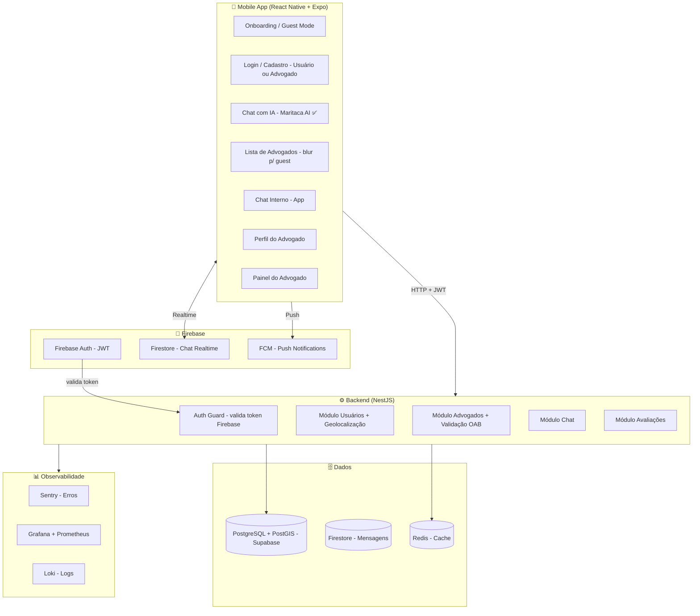
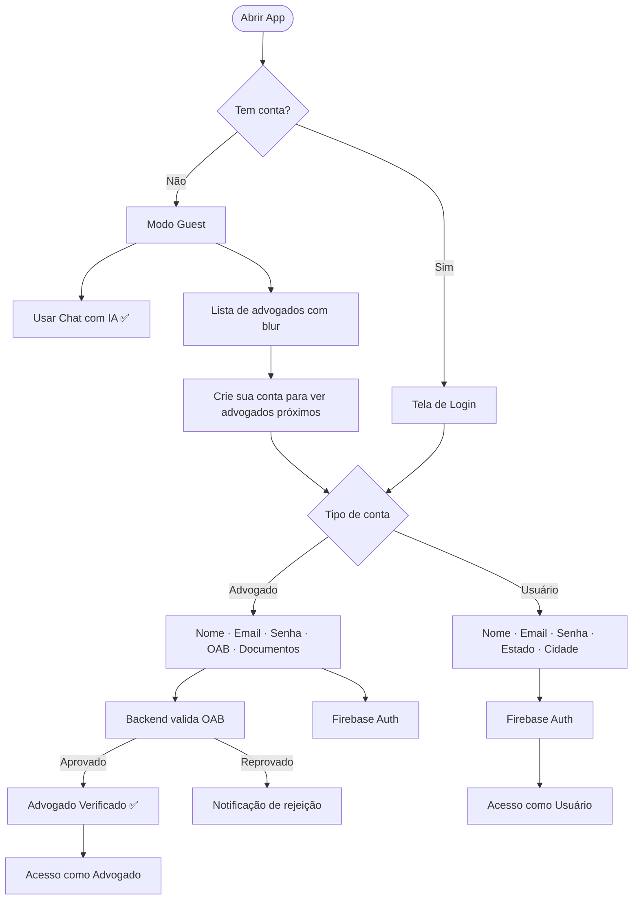
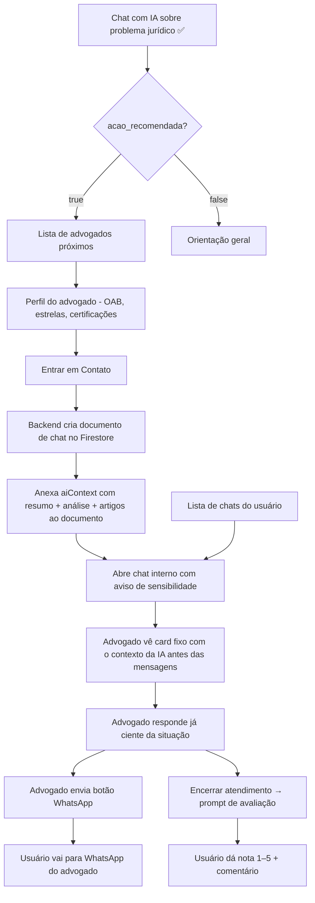
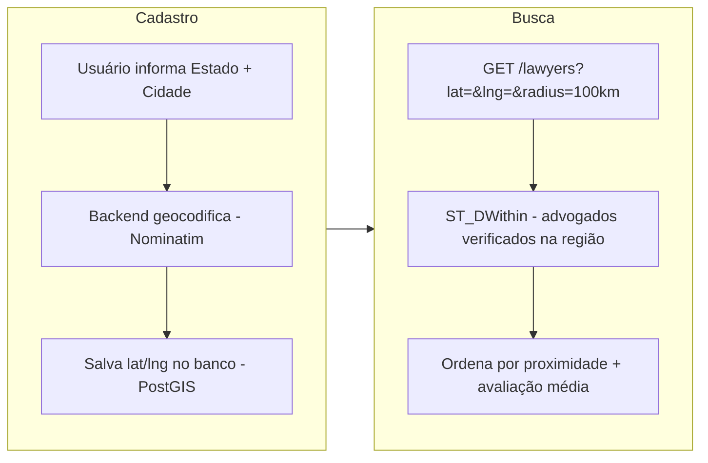
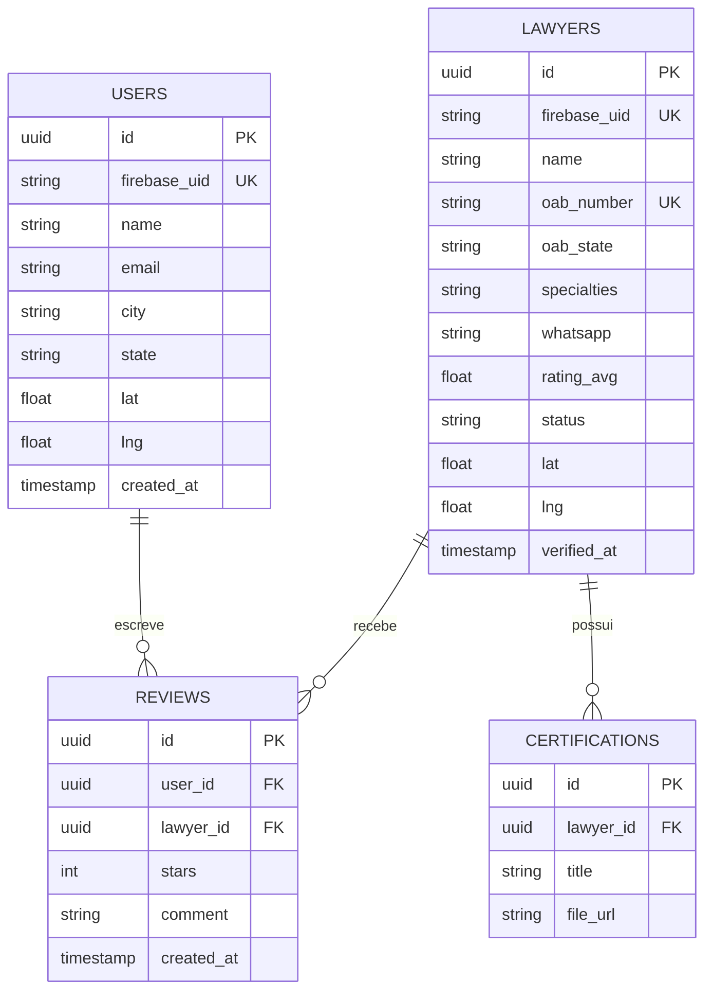
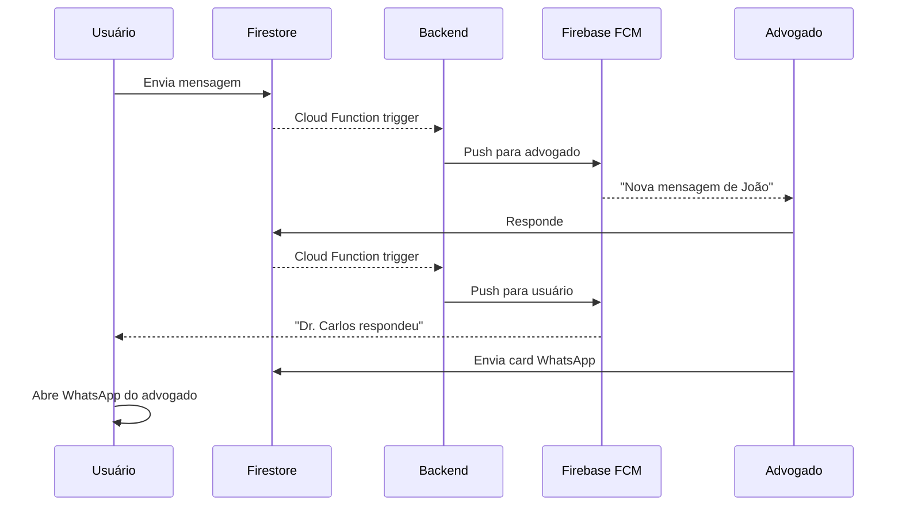

# ⚖️ JuridicAI — Plataforma de Consultoria Jurídica com IA

> Conectando cidadãos a advogados locais com inteligência artificial, autenticação robusta e comunicação segura.

---

## 📦 Estado Atual do Projeto

```
JuridicAI/
├── App.tsx              ✅ Chat com IA (single screen, dark mode)
├── src/
│   ├── services/api.ts  ⚠️ Chama Maritaca AI diretamente — deve ser movido para o backend
│   └── types/index.ts   ✅ Tipos Message e AIResponseData
├── package.json         React Native 0.81 + Expo 54
└── .env                 EXPO_PUBLIC_MARITACA_API_KEY
```

### ✅ O que já funciona
- Chat funcional com Maritaca AI (`sabiazinho-4`) — modelo brasileiro
- Parsing do JSON estruturado retornado pela IA (`resumo`, `analise`, `artigos`, `vara`, `acao_recomendada`, `ratio_decidendi`)
- Envio automático de comprovante por e-mail após cada consulta
- UI dark mode estilo ChatGPT, mobile-first

> [!WARNING]
> A chamada à Maritaca AI está atualmente no app mobile (`src/services/api.ts`), expondo a API key no bundle do aplicativo. **Isso deve ser corrigido na Fase 1**: o app passará a chamar um endpoint próprio do backend (`POST /ai/analyze`), que fará a chamada à Maritaca de forma segura no servidor.

### ❌ O que ainda não existe
- Navegação entre telas
- Autenticação (Firebase Auth)
- Backend próprio (NestJS)
- Lista de advogados
- Chat interno entre usuário e advogado
- Perfil de advogado
- Avaliações com estrelas
- Banco de dados
- Observabilidade

---

## 📐 Arquitetura Planejada



---

## 🛠️ Stack Tecnológica

| Camada | Tecnologia | Justificativa |
|---|---|---|
| **Mobile** | React Native + Expo | Codebase único iOS/Android, já em uso ✅ |
| **IA** | Maritaca AI (`sabiazinho-4`) via Backend | Modelo brasileiro, já integrado no app — chamada sendo migrada para o backend por segurança |
| **Autenticação** | Firebase Auth | Cobre email/senha, OAuth, JWT — zero infra própria |
| **Backend** | NestJS (Node.js) | Modular, TypeScript nativo, integra Firebase Admin SDK |
| **Banco Principal** | PostgreSQL via Supabase | Suporta PostGIS para queries de geolocalização (`ST_DWithin`) |
| **Chat Realtime** | Firestore | Mensagens em tempo real sem WebSockets manuais |
| **Cache** | Redis | Rate limiting, cache de listas de advogados por região |
| **Validação OAB** | Scraper + Cache | Consulta pública em `cna.oab.org.br`, resultado cacheado por 24h |
| **Métricas/Logs** | Sentry + Grafana + Loki | Crash reports no mobile, métricas de API, logs estruturados |
| **Notificações** | FCM | Nativo ao Firebase, cobre iOS e Android |

---

## 🗺️ Fluxo de Autenticação



---

## 🗺️ Jornada Principal do Usuário



---

## 🗺️ Geolocalização



---

## 📋 Roadmap

> **Regra:** cada fase é pré-requisito da próxima. Sem auth não há localização. Sem localização a lista não faz sentido. Sem lista o chat interno não existe.

---

### ✅ FASE 0 — Chat com IA (Concluído — com refatoração pendente)

- Chat funcional com Maritaca AI
- Parsing estruturado JSON
- UI dark mode mobile-first 
- Envio de comprovante por e-mail

> [!IMPORTANT]
> **Refatoração obrigatória na Fase 1:** a lógica de comunicação com a Maritaca AI (`src/services/api.ts`) deve ser extraída do app mobile e implementada no backend como o endpoint `POST /ai/analyze`. O mobile apenas enviará o texto do usuário e receberá o JSON estruturado. Isso é necessário para:
> - **Segurança:** a `EXPO_PUBLIC_MARITACA_API_KEY` atualmente fica exposta no bundle do app
> - **Controle do system prompt:** versionamento e ajuste do prompt sem atualizar o app
> - **Observabilidade:** logs e métricas de uso da IA centralizados no backend
> - **Rate limiting:** controle de abuso por usuário no servidor

---

### 🔜 FASE 1 — Navegação + Autenticação *(próxima)*

**Complexidade:** 🔴 Alta | **Estimativa:** 2–3 semanas

**O que fazer:**
- Instalar `@react-navigation/native` + `@react-navigation/stack`
- Criar estrutura de screens em `src/screens/`
- Mover `App.tsx` → `src/screens/ChatScreen.tsx`
- Configurar Firebase project (Auth habilitado)
- Instalar `firebase` e `@react-native-firebase/app`
- Criar `src/services/firebase.ts`
- Telas: `WelcomeScreen`, `LoginScreen`, `RegisterUserScreen` (com estado/cidade), `RegisterLawyerScreen` (com OAB + docs)
- Backend NestJS: rota de validação do token Firebase como middleware global
- **Criar endpoint `POST /ai/analyze` no backend** — recebe o texto do usuário, chama a Maritaca AI com o system prompt, retorna JSON estruturado
- **Remover `EXPO_PUBLIC_MARITACA_API_KEY` do app** — substituir por chamada autenticada ao endpoint do backend
- A API key da Maritaca passa a viver apenas em variáveis de ambiente do servidor

**Justificativa:** Sem usuário autenticado com localização, não é possível mostrar advogados próximos. Sem tipo de conta (user/lawyer), não há como diferenciar as rotas do app.

---

### 🔜 FASE 2 — Guest Mode + Blur na Lista

**Complexidade:** 🟢 Baixa | **Estimativa:** 1 semana

**O que fazer:**
- Quando `acao_recomendada === true` no chat (já existe ✅), exibir card com lista de advogados
- Guest vê lista com blur + banner CTA
- Usuário logado navega para `LawyerListScreen`
- Backend NestJS: endpoint `GET /lawyers?lat=&lng=&radius=100` com PostGIS

**Justificativa:** O gatilho `acao_recomendada` já existe no código. Basta conectar a navegação e o endpoint.

---

### 🔜 FASE 3 — Perfil do Advogado + Lista por Geolocalização

**Complexidade:** 🟡 Média-Alta | **Estimativa:** 2 semanas

**O que fazer:**
- Tela `LawyerProfileScreen`: foto, nome, OAB, especialidades, certificações (upload PDF/imagem), nota média
- Tela `LawyerListScreen`: cards com foto, nome, cidade, estrelas, badge verificado
- Backend: CRUD de advogados, upload de certificações (Supabase Storage)
- Validação OAB: scraper do `cna.oab.org.br` com cache Redis

---

### 🔜 FASE 4 — Chat Interno + Contexto da IA + Botão WhatsApp

**Complexidade:** 🔴 Alta | **Estimativa:** 2–3 semanas

**O que fazer:**

**Criação do chat com contexto:**
- Ao clicar em "Entrar em Contato", o app envia ao backend o `aiContext` (objeto `AIResponseData` da conversa atual) junto ao `lawyerId`
- Backend cria um documento no Firestore com estrutura:
  ```json
  {
    "userId": "...",
    "lawyerId": "...",
    "status": "open",
    "aiContext": {
      "resumo": "...",
      "analise": "...",
      "artigos": [...],
      "vara": "...",
      "acao_recomendada": true,
      "ratio_decidendi": "..."
    },
    "createdAt": "..."
  }
  ```
- O campo `aiContext` **não é uma mensagem** — é metadata do chat, exibida como um card fixo antes da conversa

**Visualização pelo advogado:**
- No painel do advogado, cada chat lista: nome do usuário + trecho do `resumo`
- Ao abrir o chat, o advogado vê um **card de contexto fixo no topo** (não rolável junto com as mensagens), com: resumo, análise, artigos, vara e `acao_recomendada`
- Isso elimina perguntas redundantes — o advogado já sabe do que se trata antes de digitar qualquer coisa

**Lista de chats do usuário:**
- O usuário também possui uma tela de chats ativos e histórico
- Cada item da lista exibe: foto + nome do advogado, trecho da última mensagem e data
- Ao abrir, o usuário vê o mesmo card de contexto da IA no topo (o próprio resumo da consulta que originou o contato)
- Badge de mensagens não lidas por conversa

**Restante do chat:**
- Aviso fixo abaixo do contexto: *"Este não é um lugar para tratar informações sensíveis..."*
- Mensagens em tempo real via Firestore (`chats/{id}/messages`)
- Notificações push via FCM ao receber mensagem
- Advogado cadastra número de WhatsApp no perfil
- Botão no chat que abre `https://wa.me/{numero}?text=...`

---

### 🔜 FASE 5 — Avaliações com Estrelas

**Complexidade:** 🟢 Média | **Estimativa:** 1 semana

**O que fazer:**
- Advogado clica em "Encerrar atendimento" → usuário recebe prompt de avaliação
- Nota de 1–5 estrelas + comentário opcional
- Backend calcula e atualiza média do advogado
- Avaliações exibidas no perfil público com paginação

---

### 🔜 FASE 6 — Observabilidade + LGPD

**Complexidade:** 🟡 Média | **Estimativa:** 2 semanas

**O que fazer:**
- **Sentry** no mobile (crashes, performance) e no backend (exceptions)
- **Prometheus + Grafana** para métricas de latência e throughput da API
- **Loki** para logs estruturados do backend
- Rate limiting por IP/usuário nas rotas de IA e chat
- Mecanismo de exclusão de conta (LGPD Art. 18)
- Política de privacidade in-app

---

## 📊 Resumo

| # | Feature | Complexidade | Estimativa | Estado |
|---|---|---|---|---|
| 0 | Chat com IA + Comprovante e-mail | 🔴 Alta | — | ✅ Concluído |
| 1 | Navegação + Auth + Cadastro dual | 🔴 Alta | 2–3 sem | 🔜 Próximo |
| 2 | Guest mode + Blur + Lista básica | 🟢 Baixa | 1 sem | ⏳ |
| 3 | Perfil advogado + Geolocalização | 🟡 Média-Alta | 2 sem | ⏳ |
| 4 | Chat interno + Botão WhatsApp | 🔴 Alta | 2–3 sem | ⏳ |
| 5 | Avaliações com estrelas | 🟢 Média | 1 sem | ⏳ |
| 6 | Observabilidade + LGPD | 🟡 Média | 2 sem | ⏳ |
| **Total restante** | | | **~10–12 sem** | |

---

## 🗂️ Estrutura de Pastas Planejada

```
JuridicAI/
├── apps/
│   ├── mobile/                      # React Native + Expo (atual ✅)
│   │   └── src/
│   │       ├── screens/
│   │       │   ├── auth/            # Welcome, Login, RegisterUser, RegisterLawyer
│   │       │   ├── ChatScreen.tsx   # Mover App.tsx aqui
│   │       │   ├── LawyerListScreen.tsx
│   │       │   ├── LawyerProfileScreen.tsx
│   │       │   ├── InternalChatScreen.tsx
│   │       │   └── LawyerPanelScreen.tsx
│   │       ├── services/
│   │       │   ├── api.ts           # ⚠️ Refatorar: remover chamada Maritaca → usar POST /ai/analyze do backend
│   │       │   └── firebase.ts      # Auth + Firestore
│   │       ├── navigation/
│   │       │   └── AppNavigator.tsx
│   │       └── types/index.ts       # ✅
│   │
│   └── backend/                     # NestJS (a criar)
│       ├── src/modules/
│       │   ├── auth/
│       │   ├── users/
│       │   ├── lawyers/
│       │   ├── chat/
│       │   ├── geo/
│       │   └── reviews/
│       └── prisma/schema.prisma
│
└── packages/
    └── shared-types/                # DTOs compartilhados
```

---

## 🗄️ Modelo de Dados



---

## 🔔 Fluxo de Notificações



---

## 📎 Referências

- [Firebase Auth](https://firebase.google.com/docs/auth)  
- [Supabase + PostGIS](https://supabase.com/docs/guides/database/extensions/postgis)  
- [NestJS](https://docs.nestjs.com)  
- [Maritaca AI](https://chat.maritaca.ai)  
- [Consulta OAB Pública](https://cna.oab.org.br)  
- [Sentry React Native](https://docs.sentry.io/platforms/react-native/)
